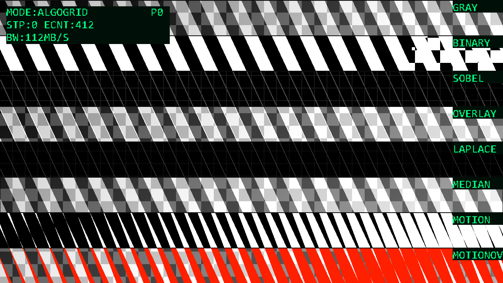
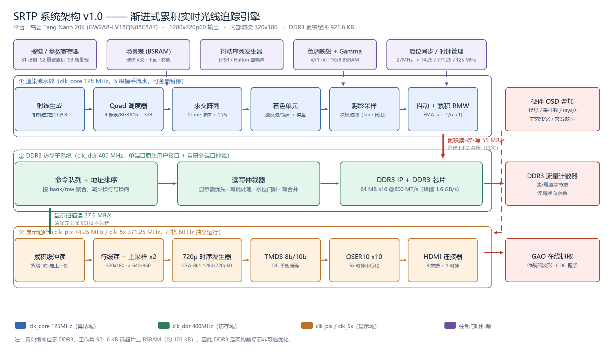

# PSVE-20K 幻源引擎

**无摄像头的自生视频流实时处理平台**，在 Gowin Tang Nano 20K（GW2AR-18）上用纯 RTL 实现。

<sub>English: A camera-free procedural video engine on a low-cost domestic FPGA. The image source is synthesized in RTL, passed through a parallel 3×3 neighbourhood pipeline, and shown on HDMI as a left/right split comparison. No camera, no external sensor, no host computer.</sub>



---

## 为什么没有摄像头

一旦引入摄像头，输入就不确定了：同样的算法今天和明天的输出不一样，阈值调到哪里算"对"也没法当场说清，实时性只能靠嘴讲。

这里把图像源也做成硬件。画面由 RTL 逐像素合成——旋转条纹、移动棋盘、呼吸圆环与对角渐变叠加成一个连续变化的空间梯度场。于是：

- 输入完全确定、可复现，每条处理结果都能和预期对上；
- 图案参数是寄存器，评审想看算法在什么条件下失效，可以当场改；
- 整条链路都在片内，没有传感器驱动的黑盒，实时性可以用硬件计数器自证。

---

## 特性

| 项目 | 规格 |
|---|---|
| 显示输出 | HDMI 1280×720p60，TMDS 8b/10b + OSER10，像素时钟 74.25 MHz |
| 图像源 | 解析合成四种图案叠加，无 ROM 图像、无外部输入 |
| 算法核 | 灰度、二值化、Sobel、Laplacian、9 点精确中值、时域帧差 |
| 显示模式 | 9 档：GRAY / BINARY / SOBEL / OVERLAY / LAPLACE / MEDIAN / LIVE / FULLEDGE / ALGOGRID |
| 算法对比栅格 | 一屏 6 条横带、6 种算法、同一帧画面并行运算 |
| 邻域窗口 | 3 片行缓存三相位轮转，读写永不落在同一片 |
| 在线观测 | 三页硬件字符 OSD，数字由硬件计数器直出 |
| 存储控制器 | 自研 SDR SDRAM 控制器（无厂商 IP 依赖），独立自检 16/16 通过 |
| 规模 | 11 个 Verilog 模块，约 2200 行，综合 0 error 0 warning |

---

## 系统架构



四级流水：

1. **图像生成**：五级流水与四个乘法器，正弦表驱动旋转条纹；
2. **邻域窗口**：三片行缓存轮转成 3×3 窗口；
3. **算法与合成**：六个算法核共享窗口，一级选择器决定输出；
4. **显示**：上采样、OSD 叠加、TMDS 编码。

时钟只有三个来源：27 MHz 晶振经 rPLL 得 371.25 MHz，五分频得 74.25 MHz 像素时钟；算法域与像素域同源，主通路中不存在跨时钟域问题。

---

## 构建

1. 安装 **Gowin EDA V1.9.11.03 Education**（其他版本需自行验证）
2. 打开 `psve20k.gprj`
3. `Synthesize` → `Place & Route`
4. 产物在 `impl/pnr/psve20k.fs`

工程已包含官方 HDMI 例程的 `dvi_tx.v` 与 `TMDS_rPLL.v`，无需额外下载。

> `verify/` 目录里是综合验证用的 IP 桩，**不要加入正式工程**（会与真实 IP 冲突）。

## 烧录

```bash
# 调试：写 SRAM，掉电丢失，约 5 秒
programmer_cli.exe -d GW2AR-18C --fsFile impl/pnr/psve20k.fs -r 2

# 固化：写板载 Flash，掉电保留，含校验，约 22 秒
programmer_cli.exe -d GW2AR-18C --fsFile impl/pnr/psve20k.fs -r 9 --spiaddr 0x000000
```

`prebuilt/psve20k_clean.fs` 是已验证的现成比特流。注意 GW2A 系列不支持 SRAM 回读，
带校验的 SRAM 操作会报 `Verify Failed`，以退出码 0 为准；Flash 的校验是真实的。

---

## 目录结构

```
psve20k.gprj           Gowin 工程
src/                   工程源码（14 个文件，含官方 DVI IP 与约束）
diag/                  SDRAM 控制器自检固件（独立顶层）
verify/                综合验证桩（不要加入工程）
tools/                 字库生成、OSD 与算法栅格的预览脚本
doc/                   技术文档、题目与简介、答辩准备
images/                README 插图
prebuilt/              已验证比特流
```

---

## 实现要点

**精确中值**：冒泡排序前四轮会把四个最大值推到尾部，此时前五个即最小的五个，取其中最大值为第五大，也就是中值。据此得到 30 级比较交换网络，并用穷举法验证了 9 个元素的全排列 362880 种。常见的"每列排序后取中间行"只是近似。

**算法栅格**：行缓存保存的是源亮度而非算法中间结果，六个算法可以对同一窗口并行运算。把屏幕按行分带、每带绑定一个算法，就能一屏横向对比六种算法，代价只是一级选择器。

**自研 SDRAM 控制器**：所选工具链的免费版不提供嵌入式 SDRAM 控制器 IP，完整版需联网授权。控制器自行实现上电初始化（200 µs 等待 → PRECHARGE ALL → 2× AUTO REFRESH → LOAD MODE，CL=3/BL=1）、行激活-突发读写-自动预充电与周期刷新。读通路的难点在于突发内命令背靠背发出、数据也背靠背返回，必须边发边收。

---

## 当前状态与限制

板级实测结果如实列出：

| 项 | 状态 |
|---|---|
| HDMI 720p60 输出、9 档模式、分屏、算法栅格、OSD | 正常 |
| SDRAM 控制器读写自检（16 字回读比对） | 通过，0 错误 |
| 帧缓存写入吞吐 | **仅达设计值 28%**（约 256 KB/帧，设计 900 KB） |
| 依赖整帧存储的时域功能（帧延迟、运动检测、时间切片） | **暂不可用**，已从模式循环中移除 |

吞吐瓶颈已量化：每个突发实际占用约 72 个周期，而时序设计值为 29 个周期，瓶颈集中在写方向的命令/数据握手。后续需要用片内逻辑分析仪抓取写授权、忙信号与突发计数三组波形继续定位。

演示固件因此采用行缓存直通模式：3×3 窗口与六个算法核完全不受影响，OSD 中的 `BW` 字段显示 000 属于该模式的正常表现。

---

## 致谢

HDMI 输出所用的 `dvi_tx.v`、`TMDS_rPLL.v` 来自 Gowin / Sipeed 公开的 Tang Nano 20K 示例；
本项目的其余 RTL、脚本、文档均为自行编写。

## English

A camera-free real-time image-processing platform on the Gowin Tang Nano 20K (GW2AR-18).
The image source is synthesized in RTL (rotating stripes, moving checkerboard, breathing rings,
diagonal gradient), processed by six parallel 3×3-neighbourhood kernels sharing one window, and
displayed over HDMI 720p60 as a left/right comparison. The SDRAM controller is implemented from
scratch and verified by an independent 16-word read-back self-test. Known limitation: frame-buffer
write throughput reaches only 28% of the design value, so temporal features are disabled in the
demo build.
